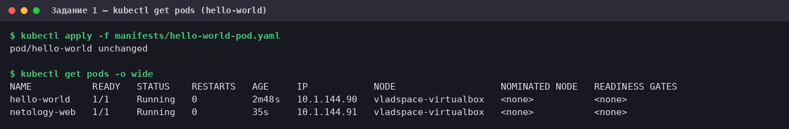
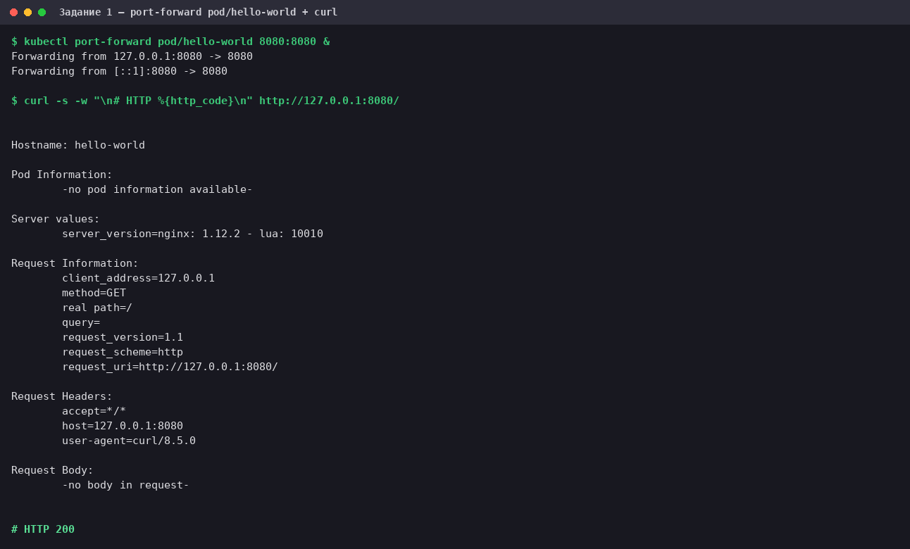
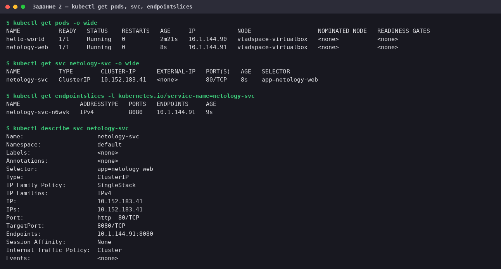
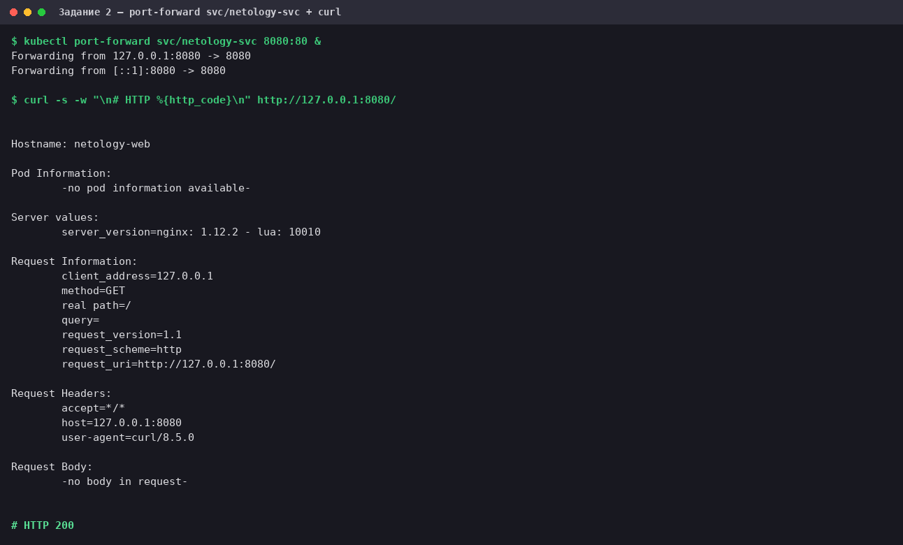
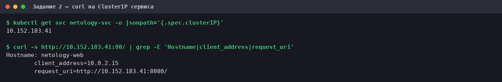

# Домашнее задание к занятию «Kubernetes. Pod и Service»

Стенд из предыдущего ДЗ: Oracle VirtualBox VM (Ubuntu 24.04.4 LTS), MicroK8s **v1.35.6** (один узел),
локальный `kubectl` **v1.37.1**, kubeconfig на `https://10.0.2.15:16443`.

Манифесты лежат в каталоге [`manifests/`](manifests/):

| Файл | Объект |
|---|---|
| [`hello-world-pod.yaml`](manifests/hello-world-pod.yaml) | Pod `hello-world` (задание 1) |
| [`netology-web-pod.yaml`](manifests/netology-web-pod.yaml) | Pod `netology-web` (задание 2) |
| [`netology-svc.yaml`](manifests/netology-svc.yaml) | Service `netology-svc` (задание 2) |

Сырые логи команд — в [`logs/`](logs/), скриншоты — в [`img/`](img/).

## Задание 1. Pod `hello-world`

### 1.1. Манифест

[`manifests/hello-world-pod.yaml`](manifests/hello-world-pod.yaml):

```yaml
apiVersion: v1
kind: Pod
metadata:
  name: hello-world
  labels:
    app: hello-world
spec:
  containers:
    - name: echoserver
      image: gcr.io/kubernetes-e2e-test-images/echoserver:2.2
      ports:
        - containerPort: 8080
```

`containerPort: 8080` — echoserver слушает именно этот порт. Поле информационное: порт доступен и без него,
но так манифест сразу показывает, куда обращаться.

### 1.2. Запуск

```bash
kubectl apply -f manifests/hello-world-pod.yaml
kubectl wait --for=condition=Ready pod/hello-world --timeout=240s
kubectl get pods -o wide
```



Pod стал `Ready` примерно через 107 секунд — большая часть времени ушла на скачивание образа с `gcr.io`;
повторный `apply` вернул `pod/hello-world unchanged`: манифест идемпотентен.

### 1.3. Подключение через `port-forward`

```bash
kubectl port-forward pod/hello-world 8080:8080 &
curl -s http://127.0.0.1:8080/
```



В ответе `Hostname: hello-world` — имя Pod, то есть запрос дошёл именно до него. Полный лог:
[`logs/02_hello_port_forward.log`](logs/02_hello_port_forward.log).

## Задание 2. Service `netology-svc` и Pod `netology-web`

### 2.1. Манифесты

[`manifests/netology-web-pod.yaml`](manifests/netology-web-pod.yaml) — тот же образ, но с меткой `app: netology-web`:

```yaml
apiVersion: v1
kind: Pod
metadata:
  name: netology-web
  labels:
    app: netology-web
spec:
  containers:
    - name: echoserver
      image: gcr.io/kubernetes-e2e-test-images/echoserver:2.2
      ports:
        - containerPort: 8080
```

[`manifests/netology-svc.yaml`](manifests/netology-svc.yaml):

```yaml
apiVersion: v1
kind: Service
metadata:
  name: netology-svc
spec:
  type: ClusterIP
  selector:
    app: netology-web
  ports:
    - name: http
      protocol: TCP
      port: 80
      targetPort: 8080
```

Service связывается с Pod **не по имени, а по меткам**: `selector: app=netology-web` совпадает с
`labels.app` у Pod `netology-web`. Service принимает трафик на порт `80` (`port`) и отдаёт в контейнер на `8080`
(`targetPort`).

### 2.2. Запуск

```bash
kubectl apply -f manifests/netology-web-pod.yaml -f manifests/netology-svc.yaml
kubectl wait --for=condition=Ready pod/netology-web --timeout=240s
kubectl get pods -o wide
kubectl get svc netology-svc -o wide
kubectl get endpointslices -l kubernetes.io/service-name=netology-svc
kubectl describe svc netology-svc
```



Ключевое — `Endpoints: 10.1.144.91:8080` в `describe`: это IP Pod `netology-web` из столбца `IP` в
`get pods`, то есть Service нашёл Pod по селектору. Лог: [`logs/03_web_get_pods_svc.log`](logs/03_web_get_pods_svc.log).

### 2.3. Подключение к Service через `port-forward`

```bash
kubectl port-forward svc/netology-svc 8080:80 &
curl -s http://127.0.0.1:8080/
```



В ответе `Hostname: netology-web`. В строке `Forwarding from 127.0.0.1:8080 -> 8080` видно, что порт Service
`80` kubectl пересчитал в `targetPort` `8080`. Лог: [`logs/04_svc_port_forward.log`](logs/04_svc_port_forward.log).

### 2.4. Дополнительно: проверка самого Service через ClusterIP

**`kubectl port-forward svc/...` не проходит через ClusterIP и kube-proxy.** kubectl по селектору сервиса сам
выбирает один Pod и пробрасывает порт напрямую в него — то есть эта проверка подтверждает связь «Service → Pod»,
но не работу виртуального IP. Чтобы проверить и его, VM (она же узел кластера) обращается к ClusterIP напрямую:

```bash
curl -s http://$(kubectl get svc netology-svc -o jsonpath='{.spec.clusterIP}'):80/ \
  | grep -E 'Hostname|client_address|request_uri'
```



Запрос на `10.152.183.41:80` дошёл до Pod `netology-web` (`Hostname: netology-web`) — значит, kube-proxy
транслирует адрес Service в адрес Pod. `client_address=10.0.2.15` — адрес узла, с которого шёл `curl`.
Лог: [`logs/05_clusterip_curl.log`](logs/05_clusterip_curl.log).

## Нюансы

- **Образ.** `gcr.io/kubernetes-e2e-test-images/echoserver:2.2` доступен в реестре (манифест отдаёт HTTP 200,
  есть `linux/amd64`, `arm`, `arm64`, `ppc64le`). Тега `2.5` в этом репозитории нет (HTTP 404), поэтому
  использован именно `2.2`, как в задании.
- **`Endpoints` → `EndpointSlice`.** В Kubernetes 1.33+ `kubectl get endpoints` печатает предупреждение
  `v1 Endpoints is deprecated`, поэтому связь Service с Pod показана через `endpointslices`.
- **Локальный порт.** Оба `port-forward` использовали `8080`, но не одновременно: после проверки процесс
  останавливался (`kill`), иначе второй не смог бы занять порт.
- **`port-forward` к Service подключается к одному Pod.** За `netology-svc` стоит единственный Pod, поэтому
  в этом ДЗ различия нет; балансировку между несколькими Pod эта проверка не показывает.

## Уборка

```bash
kubectl delete -f manifests/ --ignore-not-found
```
